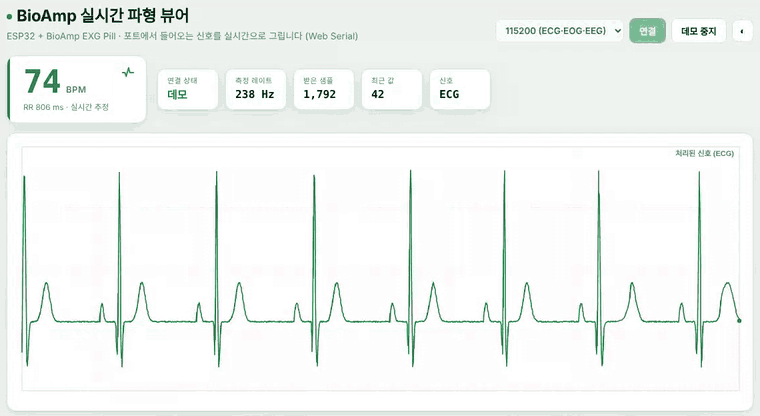
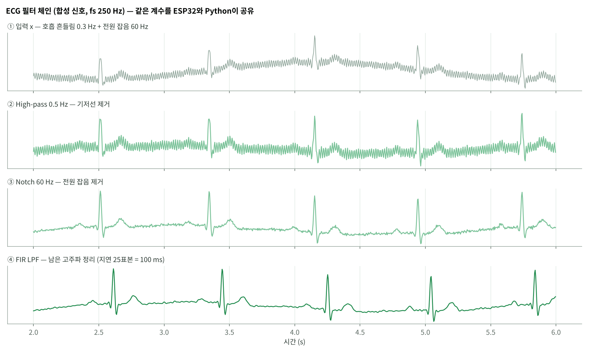
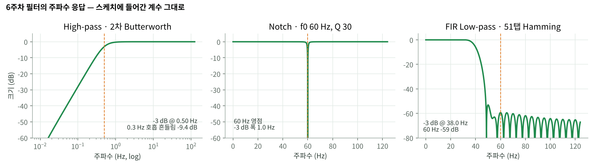
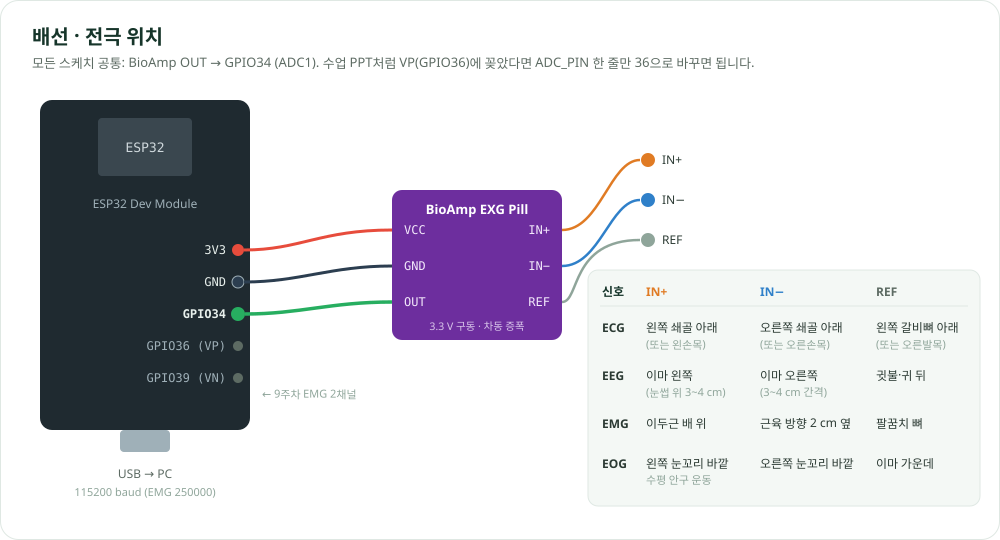

# 🫀 Biosignal Lab

**An open lab kit to measure ECG, EEG, EMG and EOG with an ESP32 + BioAmp EXG Pill, view them in the browser, and build digital filters step by step**

[**▶ Live demo**](https://gimggang89-star.github.io/biosignal-lab-esp32/) · [한국어](README.md)

Every viewer runs on a synthetic signal in the live demo, so no board is needed to try it.
I wrote this code as the teaching assistant for the *Digital Healthcare Systems* course at Konyang University (Dept. of Medical IT); the same screens were used to record visitors' ECG at a hands-on booth. The UI and comments are in Korean.

## At a glance

| | |
|---|---|
| **Signals** | ECG 250 Hz · EEG 256 Hz · EMG 500–1,000 Hz · EOG 75 Hz |
| **Firmware** | 19 sketches — zero compiler warnings with the ESP32 toolchain (arduino-esp32 2.0.17), excluding 2 fill-in-the-blank versions |
| **Web viewers** | 6, no install (Web Serial, filter comparison, R-peak / alpha / contraction / eye-movement detection) |
| **Labs** | Week 5 time-domain filters · Week 6 frequency-domain filters · Week 9 EMG onset detection |
| **Measured** | 60 Hz mains noise −58 dB (notch) · EMG: 3 contractions, 0 missed, 0 false alarms |

## Labs

| Week | What students build | What they verify |
|---|---|---|
| [5 — time domain](labs/week05_time_domain_filters) | polarity check → moving average → median → simple IIR → median→IIR → all four | how much noise is removed vs. how much R-peak height survives |
| [6 — frequency domain](labs/week06_frequency_domain_filters) | 0.5 Hz high-pass, 60 Hz notch, 51-tap FIR; coefficients from `gen_coef.py` | inject a known sine (`INJECT_HZ`) and measure attenuation |
| [9 — EMG](labs/week09_emg) | 1 kHz chain → MAV/RMS → baseline learning → hysteresis onset detection, 2 channels | transitions, misses, false alarms, latency; RMS vs. effort linearity; fatigue (median frequency) |

## Results (synthetic signals; coefficients read straight from the sketches)

| Filter | Result |
|---|---|
| High-pass (2nd-order Butterworth) | −3 dB at 0.50 Hz · −9.4 dB at 0.3 Hz (breathing drift) |
| Notch (60 Hz, Q 30) | −3 dB width 1.0 Hz · −58 dB on the synthetic ECG's 60 Hz component |
| FIR (51-tap Hamming) | −3 dB at 38 Hz · −59 dB at 60 Hz · 100 ms delay |

R-peak height kept on the same spiky input: **median 78% · IIR 65% · moving average 51%**.
Week 9 firmware detector (k = 5/3 hysteresis): 3 contractions → 6 transitions, 0 missed, 0 false alarms, ~37 ms onset latency.

## Quick start

1. Wire BioAmp `VCC→3V3`, `GND→GND`, `OUT→GPIO34`.
2. Flash `firmware/ECG_ESP32` (board: *ESP32 Dev Module*).
3. Open `viewer/bioamp_live_viewer.html` in Chrome/Edge and connect.
4. `pip install -r requirements.txt`, set `PORT` in `record/ecg_record.py`, run it, and drop the JSON onto `viewer/ecg_viewer.html`.

## Privacy & safety

Recorded biosignals are personal health data and are never committed (`.gitignore`); every sample in this repo is synthetic. The booth page writes name/sex/birth date only into the local file name. This is teaching material, not a medical device.

## Credits

BioAmp EXG Pill by [Upside Down Labs](https://github.com/upsidedownlabs/BioAmp-EXG-Pill) (MIT). Code by 김은성 ([@gimggang89-star](https://github.com/gimggang89-star)) — MIT License.
