<div align="center">

# 🫀 Biosignal Lab

**ESP32 + BioAmp EXG Pill로 심전도·뇌파·근전도·안전도를 재고, 브라우저에서 보고, 디지털 필터를 직접 만들어 보는 실습 키트**

[](https://github.com/gimggang89-star/biosignal-lab-esp32/actions/workflows/ci.yml)
[](LICENSE)


[**▶ 라이브 데모**](https://gimggang89-star.github.io/biosignal-lab-esp32/) · [English](README.en.md)

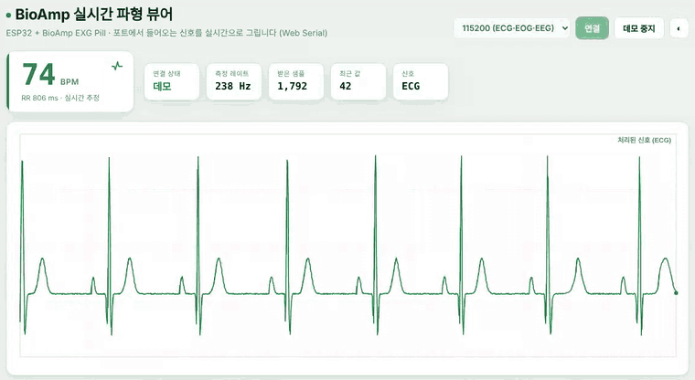

</div>

보드 없이도 위 데모 링크에서 모든 뷰어가 합성 신호로 바로 동작합니다.
디지털헬스케어시스템 수업 TA로 실습 자료를 만들면서 짠 코드이고, ECG 체험 부스에서도 이 화면으로 방문객 심전도를 측정했습니다.

## 한눈에

| | |
|---|---|
| **신호** | ECG 250 Hz · EEG 256 Hz · EMG 500–1,000 Hz · EOG 75 Hz |
| **펌웨어** | 스케치 19개 — ESP32 툴체인(arduino-esp32 2.0.17)으로 컴파일 경고 0 (빈칸을 채워야 하는 실습본 2개 제외) |
| **웹 뷰어** | 6개, 설치 없음 (Web Serial · 필터 비교 · R파/알파파/수축/안구 이동 검출) |
| **실습** | 5주차 시간 영역 필터 · 6주차 주파수 영역 필터 · 9주차 EMG 수축 검출 |
| **확인한 수치** | 60 Hz 전원 잡음 −58 dB (Notch) · EMG 수축 3번 검출 놓침 0 · 오검출 0 |

## 웹 뷰어

| 실시간 (Web Serial) | 심전도 |
|---|---|
| [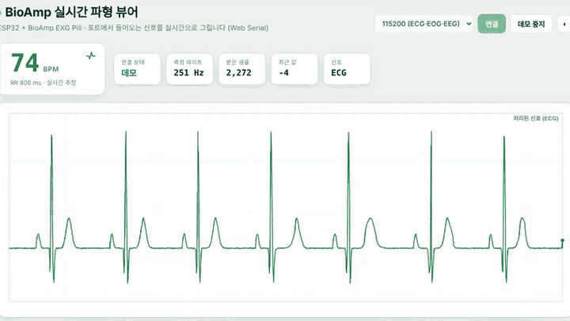](https://gimggang89-star.github.io/biosignal-lab-esp32/viewer/bioamp_live_viewer.html?demo) | [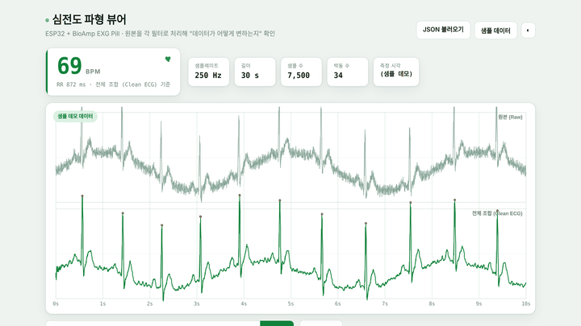](https://gimggang89-star.github.io/biosignal-lab-esp32/viewer/ecg_viewer.html) |
| 보드에서 들어오는 신호를 흐르는 그래프로, 실시간 BPM | 원본 → Median → HPF → Notch → FIR 을 버튼으로 비교, R파 검출 |
| **뇌파** | **근전도** |
| [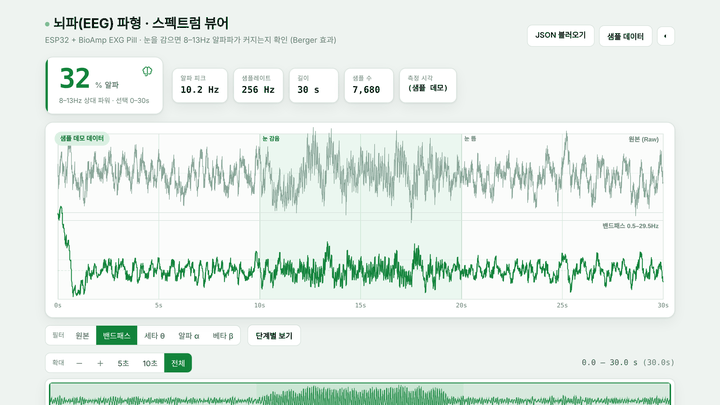](https://gimggang89-star.github.io/biosignal-lab-esp32/viewer/eeg_viewer.html) | [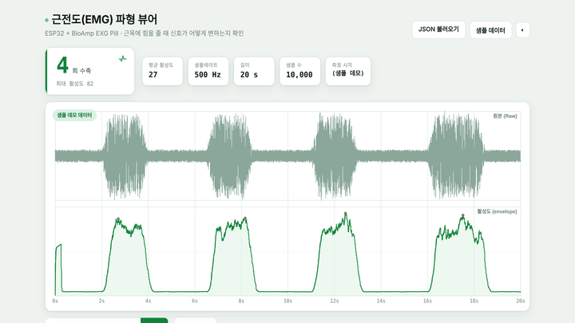](https://gimggang89-star.github.io/biosignal-lab-esp32/viewer/emg_viewer.html) |
| 눈을 감으면 커지는 알파파(Berger 효과), FFT 대역 파워 | 밴드패스 → 정류 → 활성도, 수축 횟수 |
| **안전도** | **체험 부스** |
| [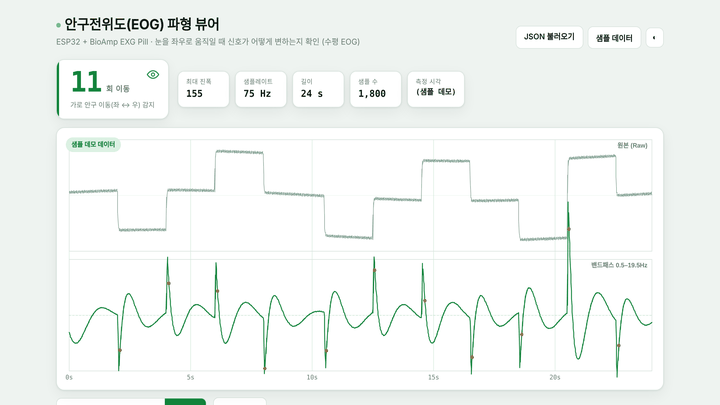](https://gimggang89-star.github.io/biosignal-lab-esp32/viewer/eog_viewer.html) | [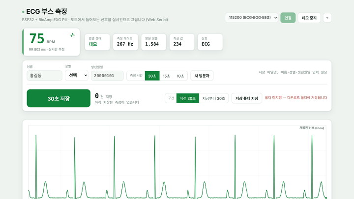](https://gimggang89-star.github.io/biosignal-lab-esp32/viewer/bioamp_booth.html?demo) |
| 좌우 안구 이동을 펄스로 검출 | 방문자별 30초 측정·저장, 서버 전송 없음 |

## 실습

| 주차 | 배우는 것 | 결과로 확인하는 것 |
|---|---|---|
| [**5주차** 시간 영역 필터](labs/week05_time_domain_filters) | 극성 확인 → 이동평균 → Median → Simple IIR → Median→IIR → 4단 종합 | 잡음은 줄이면서 R파를 얼마나 남기나 |
| [**6주차** 주파수 영역 필터](labs/week06_frequency_domain_filters) | HPF 0.5 Hz · Notch 60 Hz · FIR 51탭 계수를 `gen_coef.py`로 만들어 스케치에 넣기 | 사인파를 일부러 섞어(`INJECT_HZ`) 감쇠 측정 |
| [**9주차** 근전도](labs/week09_emg) | 1 kHz 체인 → MAV·RMS → 기저선 학습 → 히스테리시스 수축 검출, 2채널 | 전환·놓침·오검출·지연, 노력별 RMS 직선성, 근피로 MDF |

빈칸 실습본(`*_blank`, `student/`)과 완성본을 함께 두었습니다.

## 결과

모두 **합성 신호**로 만든 그림입니다. 필터 계수는 스케치에 들어간 값을 그대로 읽어 계산했습니다.

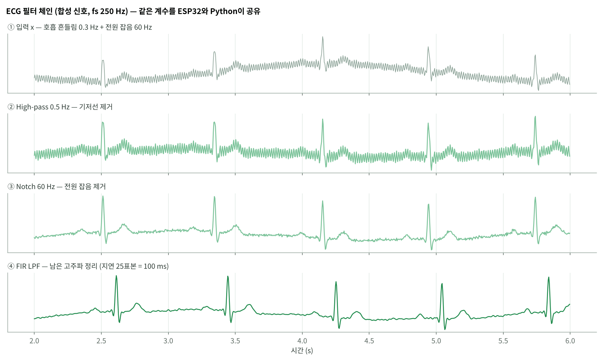

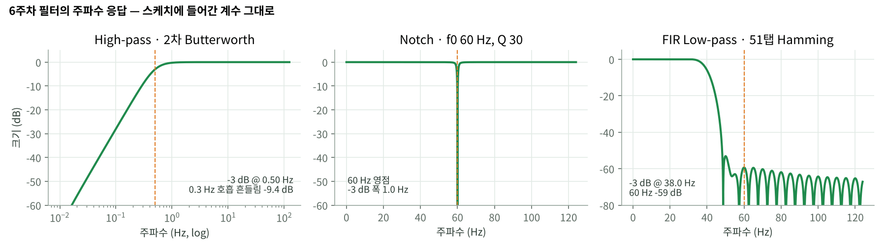

| 필터 | 확인한 값 |
|---|---|
| High-pass (2차 Butterworth) | −3 dB 0.50 Hz · 호흡 흔들림 0.3 Hz −9.4 dB |
| Notch (60 Hz, Q 30) | −3 dB 폭 1.0 Hz · 합성 ECG의 60 Hz 성분 −58 dB |
| FIR (51탭 Hamming) | −3 dB 38 Hz · 60 Hz −59 dB · 지연 100 ms |

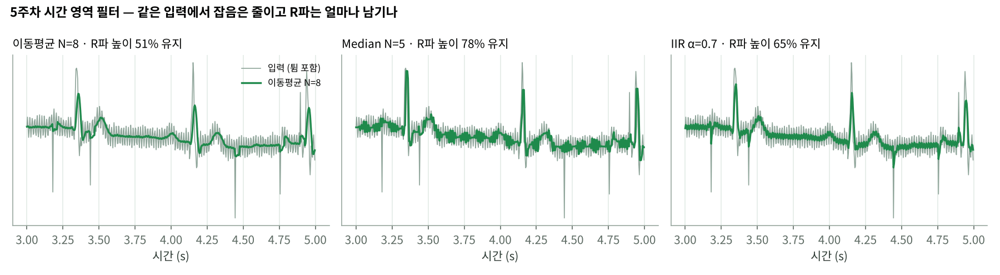

순간 튐이 섞인 같은 입력에서 R파 높이 유지율: **Median 78% · IIR 65% · 이동평균 51%**. 이동평균은 잡음을 잘 누르지만 R파도 함께 깎습니다.

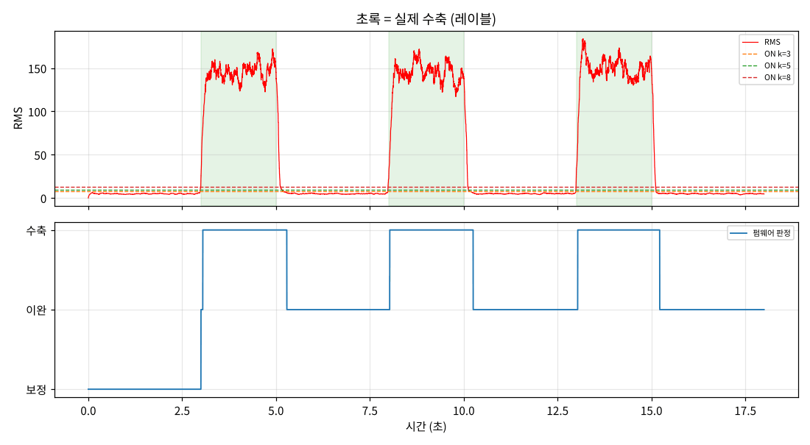

9주차 펌웨어 판정(k = 5/3 히스테리시스): 수축 3번 → 전환 6 · 놓침 0 · 오검출 0, 시작 지연 약 37 ms.

## 빠른 시작

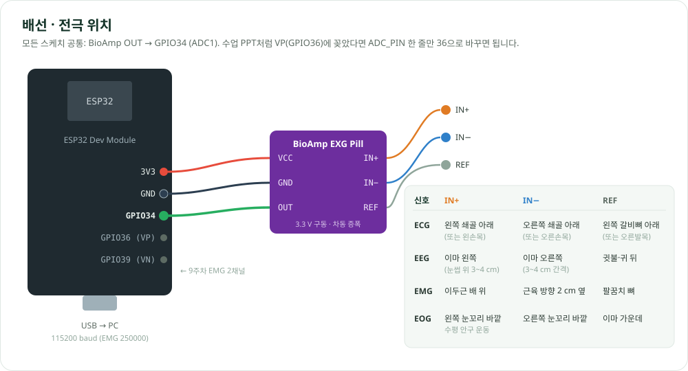

1. **배선** — BioAmp `VCC→3V3`, `GND→GND`, `OUT→GPIO34`
2. **펌웨어** — Arduino IDE, 보드 `ESP32 Dev Module`, `firmware/ECG_ESP32` 업로드
3. **보기** — Chrome/Edge에서 `viewer/bioamp_live_viewer.html` → 연결
4. **기록** — `pip install -r requirements.txt` → `record/ecg_record.py`의 `PORT` 수정 → 실행 → JSON을 `viewer/ecg_viewer.html`에 끌어놓기

## 구조

```
firmware/   ECG · EEG · EMG · EOG 스케치
record/     시리얼 → JSON 기록 (pyserial)
viewer/     설치 없는 HTML 뷰어 6개
labs/       week05 · week06 · week09 실습 (스케치 + 파이썬)
docs/img/   README 그림
index.html  GitHub Pages 첫 화면
```

## 개인정보와 안전

- 측정 데이터(JSON·CSV)는 사람의 생체신호라 레포에 넣지 않습니다(`.gitignore`). 들어 있는 샘플은 모두 합성 신호입니다.
- 부스 화면은 이름·성별·생년월일을 파일명에만 쓰고 어디로도 보내지 않습니다.
- 교육용 실습 자료이며 의료기기가 아닙니다. 진단에 쓰지 마세요.

## Credits

- BioAmp EXG Pill — [Upside Down Labs](https://github.com/upsidedownlabs/BioAmp-EXG-Pill) (MIT)
- 작성: 김은성 · 건양대학교 의료IT공학과 · 디지털헬스케어시스템 TA
- 라이선스: [MIT](LICENSE)
