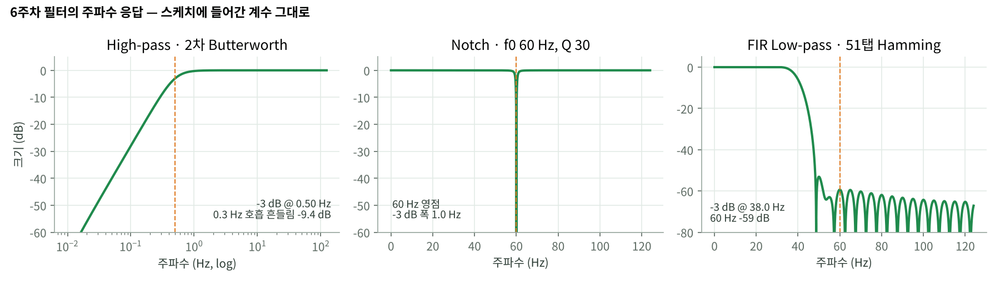

# 6주차 — 주파수 영역 디지털 필터 (HPF · Notch · FIR)

보드: ESP32 Dev Module · 115200 baud · 샘플링 250 Hz · 입력 GPIO34



| 스케치 | 내용 |
|---|---|
| `raw_check` | 입력이 들어오는지 원값만 출력 |
| `hpf` · `hpf_blank` | 2차 Butterworth High-pass 0.5 Hz (호흡에 의한 기저선 흔들림 제거) |
| `notch` | 60 Hz Notch (f0 = 60, Q = 30) |
| `fir` · `fir_blank` | 51탭 FIR Low-pass (Hamming 창), 원형 버퍼 |

`_blank` 는 차분방정식·버퍼 갱신 자리가 `__①__` 처럼 비어 있는 학생용입니다. 빈칸을 채워야 컴파일됩니다.

각 스케치 위쪽의 `INJECT_HZ` 로 0.3 / 60 / 65 Hz 같은 사인파를 일부러 섞어 넣고, 필터 전후 크기를 비교합니다.

## 실행

```bash
pip install numpy matplotlib scipy pyserial
python python/gen_coef.py hpf 0.5          # 계수 생성 → 스케치에 그대로 붙여넣기 (반올림 금지)
python python/gen_coef.py notch 60 30
python python/gen_coef.py fir 51 40
python python/viz.py live   COM5 notch     # 실시간 그래프
python python/viz.py record COM5 notch 30 run.csv
python python/viz.py report run.csv notch 60
```

`fir40.txt`, `fir101.txt` 는 탭 수를 바꿨을 때의 계수 예시입니다.

## 확인한 값 (스케치 계수 그대로, 합성 신호)

| 필터 | 값 |
|---|---|
| HPF | −3 dB 0.50 Hz · 0.3 Hz에서 −9.4 dB · 0.1 Hz에서 −28 dB |
| Notch | −3 dB 폭 1.0 Hz · 합성 ECG의 60 Hz 성분 −58 dB |
| FIR | −3 dB 38 Hz · 60 Hz에서 −59 dB · 지연 25표본(100 ms) |
