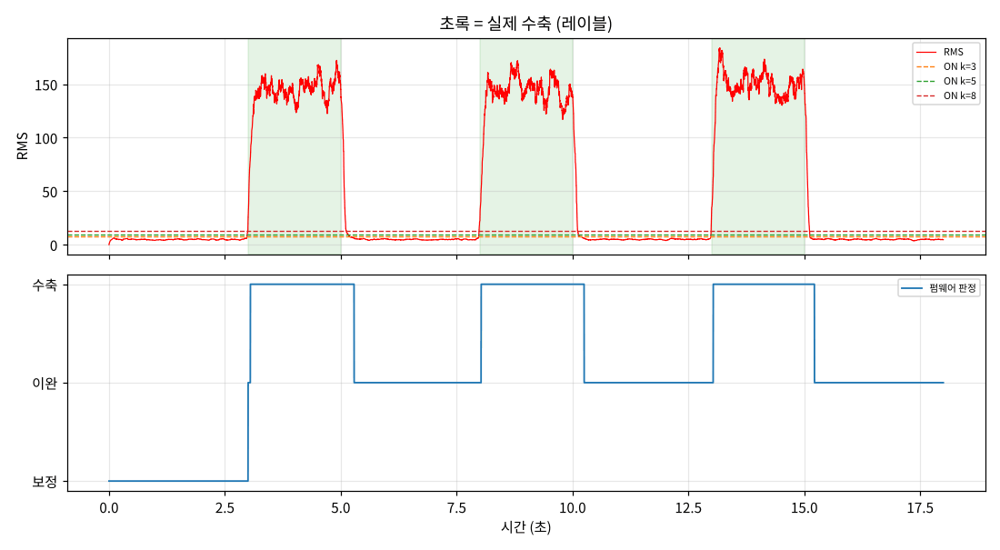

# 9주차 — 근전도(EMG) 실습

보드: ESP32 Dev Module · BioAmp EXG Pill · **1,000 Hz** · 115200 baud
배선: OUT → GPIO34 (수업 PPT처럼 VP에 꽂았다면 `ADC_PIN1 = 36`), 전극 IN+·IN− 이두근 배 위 2 cm 간격, REF 팔꿈치 뼈



## 펌웨어 체인 (`arduino/*/emg_chain`)

```
DC 제거 → HPF 20 Hz (2차 Butterworth) → Notch 60 Hz (Q 30) → 정류 → MAV · RMS (N = 100)
→ 기저선 학습 0.5–3 s (ON = μ+5σ, OFF = μ+3σ, σ 하한 0.2μ) → 히스테리시스 50/100 ms → LED (GPIO2)
```

| 폴더 | 용도 |
|---|---|
| `arduino/student/emg_chain` | 빈칸 ①②③ 버전 (정류 · 제곱합 갱신 · 히스테리시스 비교) |
| `arduino/solution/emg_chain` | 1채널 완성본 |
| `arduino/solution_2ch/emg_chain` | 2채널 (이두 GPIO34 · 삼두 GPIO39) |

출력 모드는 시리얼로 바꿉니다: `R` 원신호 · `F` 필터 후 · `P` 플로터(기본) · `B` 바이너리(1채널 4 B/표본), `c` 기저선 다시 학습, `s` 상태 한 줄.
100 표본마다 버퍼 합을 다시 계산해 float 누적 오차를 막습니다.

## 실험 (Windows: bat 더블클릭)

| bat | 실험 | 결과 |
|---|---|---|
| `00_설치확인.bat` | 보드 없이 합성 신호로 도구 점검 | 검출 표 |
| `0_파형보기.bat` | 실시간 창 (`c` = 기저선 재학습) | — |
| `1_원신호_실험1.bat` | 이완·수축 원신호 20초 | `results/e1_time.*` |
| `2_정류RMS_실험2.bat` | 빈칸 ①② 채운 뒤 RMS·MAV, SNR | `results/e2_time.*` |
| `3_노력단계_실험3.bat` | 10–100 % 노력 단계별 RMS 직선성 (R²) | `results/e3_force.*` |
| `4_수축검출_실험4.bat` | 빈칸 ③ 채운 뒤 수축 검출: 전환·놓침·오검출·지연 | `results/e4_detect.*` |
| `5_근피로_실험5.bat` | 60초 유지 → 중앙주파수(MDF) 감소 | `results/e5_fatigue.*` |
| `6_이두삼두_실험6.bat` | 2채널 굽힘·폄, 공동수축지수(CCI) | `results/e6_bipolar.*` |

화면에 "▶ 이완 / ▶ 수축!" 안내가 레이블(`labels/e*_labels.csv`) 시각에 맞춰 뜨고 1초 전에 미리 알려 줍니다. 포트는 `python/port.txt`(기본 COM4).

macOS / Linux:

```bash
pip install numpy scipy matplotlib pyserial
python python/viz.py record samples/synthetic_3_contractions.bin emg 18 results/check.csv
python python/emg_analyze.py detect results/check.csv --labels labels/e4_labels.csv
```

## 합성 신호로 확인한 결과

`samples/synthetic_3_contractions.bin` (수축 2초 × 3번, 사람 데이터 아님):

| 방법 | 전환 | 놓침 | 오검출 | 시작 지연 |
|---|---|---|---|---|
| 펌웨어 (k = 5 / 3) | 6 | 0 | 0 | 37 ms |
| k = 3 단일 임계 | 6 | 0 | 0 | 36 ms |
| k = 8 히스테리시스 | 6 | 0 | 0 | 40 ms |

## 파일

- `GUIDE.txt` — 수업 진행 순서와 기록표 옮길 곳
- `ANSWERS.txt` — 빈칸 정답과 확인 방법
- `python/viz.py` — 실시간 보기 · 기록 · `.bin/.csv` 재생, `--cue` 안내
- `python/emg_analyze.py` — `time` · `spec` · `force` · `detect` · `fatigue` · `bipolar`

수업 PPT(9. EMG 실습)의 사양에 맞춰 직접 작성했습니다. ESP32 툴체인(arduino-esp32 2.0.17)으로 세 스케치 모두 경고 없이 컴파일되고, 합성 신호와 PC 모의 보드로 6개 실험 흐름을 확인했습니다.
